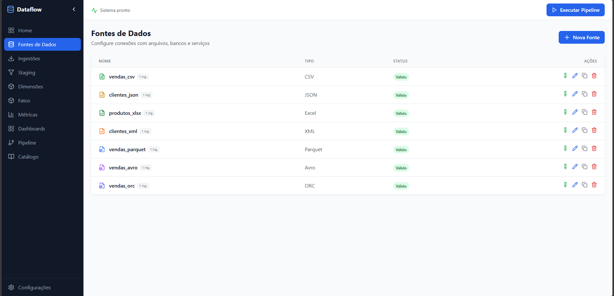
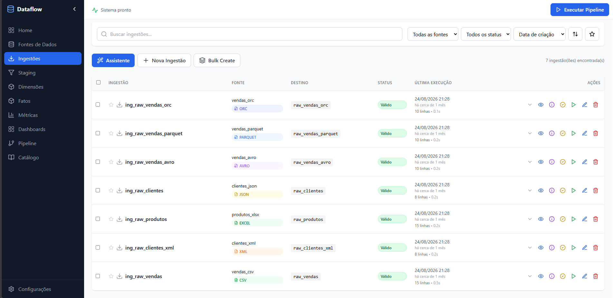
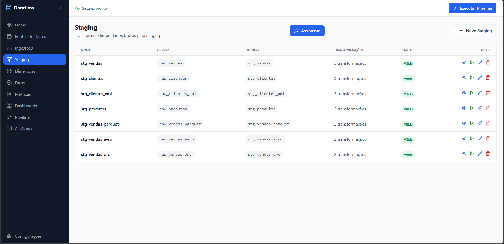
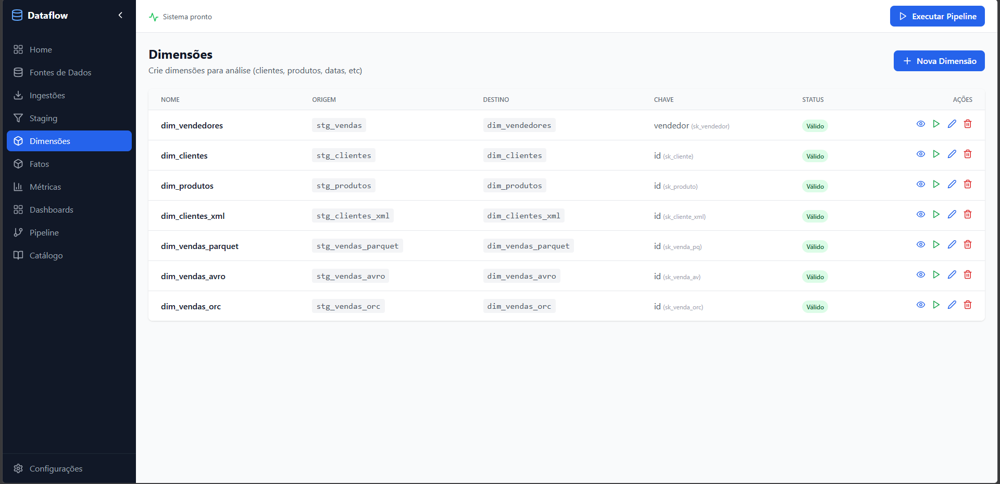
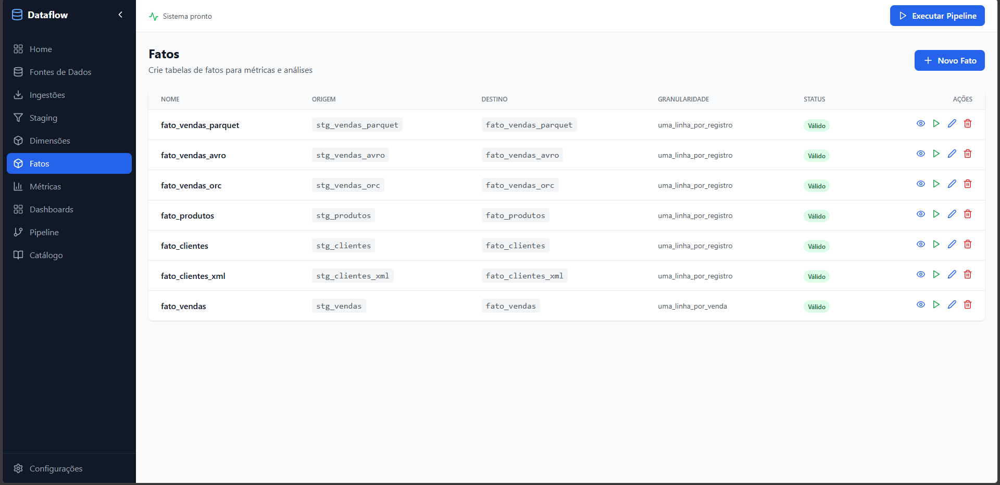
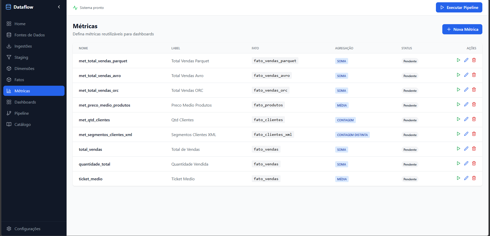
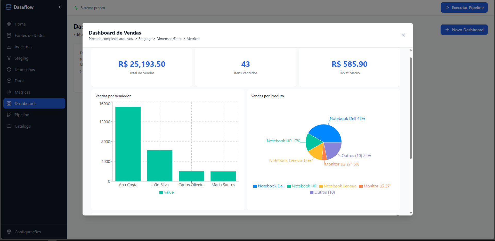
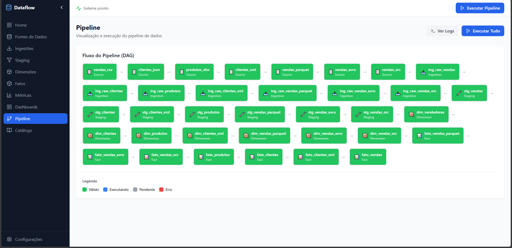
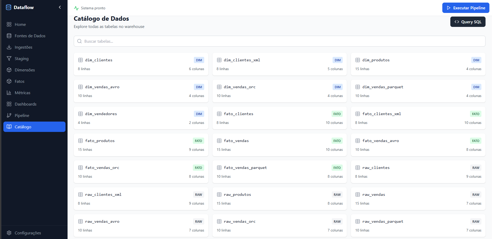

# Dataflow

Sistema local de pipeline de dados com interface web visual: ingestão, staging, modelagem dimensional, métricas e dashboards — do arquivo fonte ao gráfico, sem sair do navegador.

## 📸 Demonstração

| Fontes | Ingestão | Staging |
| --- | --- | --- |
|  |  |  |

| Dimensões | Fatos | Métricas |
| --- | --- | --- |
|  |  |  |

| Dashboards | Pipeline | Catálogo |
| --- | --- | --- |
|  |  |  |

## ✨ Funcionalidades

**Conectores de dados**
- PostgreSQL, MySQL
- Arquivos: CSV, Excel, JSON, XML, Parquet, Avro, ORC, Delta Lake, SQL file
- Google Sheets, REST API (parcial)

**Camadas do pipeline (ELT + modelagem dimensional)**
- **Ingestão** → tabelas `raw_*` com preview e execução
- **Staging** → `stg_*` com 17 transformações, construtor visual e drag-and-drop
- **Dimensões** → `dim_*` com chave natural e surrogate key
- **Fatos** → `fato_*` com medidas e granularidade
- **Métricas** → agregações com formatação (moeda, percentual, número)
- **Dashboards** → KPIs, linha, barras, pizza, área, tabela e texto (Recharts), com layout editável

**Motor de execução**
- DAG automática com NetworkX e ordenação topológica
- Execução completa ou parcial com logs e tempos
- Agendamento por cron (croniter)
- Geração automática de SQL
- Catálogo com query SQL livre (somente SELECT) e exportação CSV/Excel

**Interface**
- 11 telas, assistentes (wizards) para ingestão e staging
- Preview de dados, estados visuais (🟢🟡🔴), erros via toast
- Sidebar responsiva e tema escuro com Tailwind CSS

## 🛠️ Tecnologias

**Backend**
- Python 3 · FastAPI · Uvicorn
- SQLAlchemy + SQLite (metadata) · DuckDB (warehouse)
- Pandas · NumPy · NetworkX · croniter
- Pydantic · python-dotenv

**Frontend**
- React 18 · TypeScript · Vite
- React Router · React Query · Zustand
- Recharts · Tailwind CSS · dnd-kit · Monaco Editor

**Ferramentas**
- Docker / Docker Compose · pytest · scripts de teste (httpx)

## 📦 Instalação

**Pré-requisitos:** Python 3.10+, Node.js 18+, (opcional) Docker

```bash
git clone <repo-url>
cd dataflow
```

Backend:
```bash
cd backend
pip install -r requirements.txt
```

Frontend:
```bash
cd frontend
npm install
```

Ou, no Windows, use os atalhos na raiz:
```bash
start_all.bat      # instala dependências e sobe backend + frontend
start_backend.bat
start_frontend.bat
```

## ⚙️ Configuração

Crie o arquivo `.env` na raiz a partir do exemplo:

```bash
cp .env.example .env
```

| Variável | Padrão | Descrição |
| --- | --- | --- |
| `API_HOST` | `0.0.0.0` | Host da API |
| `API_PORT` | `8000` | Porta da API |
| `METADATA_DB_PATH` | `./data/metadata.db` | SQLite de metadados |
| `WAREHOUSE_DB_PATH` | `./data/warehouse.duckdb` | DuckDB do warehouse |
| `SECRET_KEY` | — | Chave de segurança (troque em produção) |
| `CORS_ORIGINS` | `http://localhost:5173,...` | Origens liberadas |

Os diretórios `data/` são criados automaticamente na primeira execução.

## 🚀 Como usar

```bash
# Terminal 1 — backend
cd backend && python main.py        # http://localhost:8000 (docs: /docs)

# Terminal 2 — frontend
cd frontend && npm run dev          # http://localhost:5173
```

Fluxo típico:

1. **Fontes** → cadastre PostgreSQL/MySQL ou aponte um arquivo
2. **Ingestões** → extraia para `raw_*` (com agendamento opcional)
3. **Staging** → transforme para `stg_*` no construtor visual
4. **Dimensões / Fatos** → modele em `dim_*` e `fato_*`
5. **Métricas** → defina agregações
6. **Dashboards** → monte KPIs e gráficos
7. **Pipeline** → clique em *Executar Tudo* e acompanhe os logs
8. **Catálogo** → consulte com SQL e exporte CSV/Excel

Dados de exemplo (CSV, Excel, Parquet, Avro, ORC, XML, JSON) em `exemplo-dados/`.

## 📁 Estrutura do projeto

```
dataflow/
├── backend/
│   ├── api/              # 10 módulos REST (sources, ingestions, staging, ...)
│   ├── connectors/       # postgres, mysql, csv, excel, json, xml, parquet, avro, orc, delta, sheets
│   ├── engine/           # scheduler + transform_generator
│   ├── main.py           # app FastAPI
│   ├── models.py         # SQLAlchemy
│   ├── schemas.py        # Pydantic
│   ├── database.py       # SQLite + DuckDB
│   └── Dockerfile
├── frontend/
│   └── src/
│       ├── components/   # layout, common, sources, ingestions, staging, modeling, metrics, dashboards, pipeline
│       ├── pages/        # 11 páginas
│       ├── api/          # cliente axios
│       ├── stores/       # Zustand
│       └── types/
├── scripts/              # suítes de teste por sessão
├── exemplo-dados/        # arquivos de exemplo e setups de banco
├── img/                  # screenshots
├── data/                 # metadata.db + warehouse.duckdb (gerados)
├── docker-compose.yml
└── .env.example
```

## 🧪 Testes

Suíte de aceitação cobrindo conectores e cada sessão da UI (11 etapas):

```bash
# Windows
rodar_testes.bat
```

```bash
# Manual
python backend/teste_todas_fontes.py      # conectores
python scripts/teste_ingestions_completo.py
python scripts/teste_staging_completo.py
python scripts/teste_dimensions_completo.py
python scripts/teste_facts_completo.py
python scripts/teste_metrics_completo.py
python scripts/teste_dashboards_completo.py
python scripts/teste_pipeline_completo.py
python scripts/teste_catalog_completo.py
python scripts/teste_sources_ux.py
python scripts/teste_ingestions_wizard.py
```

Guia completo de verificação manual em `GUIA_TESTE_COMPLETO.md`. Requer backend rodando.

## 🚢 Deploy

**Docker Compose:**
```bash
cp .env.example .env   # ajuste SECRET_KEY
docker compose up --build
# Frontend: http://localhost:5173
# Backend:  http://localhost:8000
```

Os dados persistem no volume `./data`. Para produção, defina `SECRET_KEY` forte, restrinja `CORS_ORIGINS` e coloque o serviço atrás de um proxy reverso com HTTPS.

## 🗺️ Roadmap

- Conector REST API completo
- Autenticação e múltiplos usuários
- Versionamento de schemas e lineage visual
- Notificações de falha de execução agendada
- Testes automatizados com pytest no CI
- Publicação de métricas como API (semantic layer)

## 🤝 Contribuindo

1. Crie um branch: `git checkout -b feature/minha-melhoria`
2. Alterações em backend (Python) ou frontend (TypeScript)
3. Rode `rodar_testes.bat` e, no frontend, `npm run build`
4. Abra um Pull Request descrevendo o contexto e a validação

Siga o estilo existente, não commite secrets (`.env`) nem arquivos gerados (`data/`, `*.log`, `__pycache__`).

## 📄 Licença

Este projeto está sob a licença [MIT](LICENSE).

```
MIT License — Copyright (c) 2026 Dataflow Project
Livre uso, cópia, modificação e distribuição, com preservação do aviso de copyright.
```
